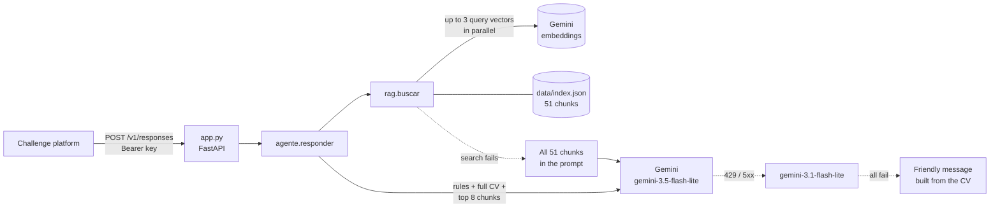

# ia-cv-agent

[](https://github.com/Angel-Larrion/ia-cv-agent/actions/workflows/ci.yml)

A conversational agent that answers questions about the professional profile of Angel Larrión (experience, skills, projects). It exposes an [Open Responses](https://www.openresponses.org/specification) endpoint, answers from a curated knowledge base with retrieval-augmented generation (RAG), and degrades gracefully when its dependencies fail.

Built with a free-tier stack: Python, FastAPI, Gemini, Docker and Render.

- **Grounded:** every answer comes from the CV and a 51-chunk project document; if the data is not there, the agent says so instead of inventing it.
- **Measured:** 61 test cases, retrieval metrics and a recorded optimization history (see [Evaluation](#evaluation)).
- **Resilient:** retry, model fallback, full-context fallback and a last-resort message. The endpoint never returns a 500 for a user question.
- **Safe by default:** mandatory API key, client instructions ignored, prompt-injection refusals, no secrets in the repo.

## Architecture



One request, step by step:

1. The platform sends the whole conversation (stateless) to `POST /v1/responses`. `app.py` checks the API key and parses the input defensively.
2. `agente.preparar()` keeps only recent user/assistant messages, strips prompt-delimiting tags and ignores any client `instructions`.
3. `rag.buscar()` embeds the question (plus up to two earlier user messages, so follow-ups like "tell me more" still find their topic) and returns the 8 most similar chunks by cosine similarity, with a small bonus for the company named in the question.
4. The prompt is built from `data/prompt.md` (rules), the full `data/cv.md` and the retrieved chunks. If the last message is clearly English, one extra line forces an English answer.
5. Gemini generates the answer inside a 40 s budget (main model with retries, then the fallback model). The reply goes back as JSON or as simulated SSE streaming.

## Knowledge and retrieval

| File | What it is | How it is used |
|---|---|---|
| `data/cv.md` | Short CV (English) | Always in the prompt, never indexed: identity, dates, titles and contact must not depend on retrieval |
| `data/proyectos.md` | 51 project and experience chunks (Spanish), one per `###` heading | Embedded once; only the top 8 enter the prompt |
| `data/index.json` | Precomputed 768-dimension embeddings, with model, dimensions and a content hash | Loaded at startup; a mismatch with `proyectos.md` triggers the full-context fallback |
| `data/prompt.md` | Behavior rules (Spanish) | System instruction |

Details and the reasoning behind each choice are in [docs/rag.md](docs/rag.md).

## Design decisions

| Decision | Why | Alternative not taken |
|---|---|---|
| Exact cosine search with NumPy | 51 vectors: sub-millisecond, exact, nothing to maintain | FAISS, HNSW, IVF, vector database (they pay off at millions of vectors) |
| Precomputed index in the repo | Saves embedding quota and latency; reproducible | Embedding the corpus at startup |
| Whole CV in the prompt, projects retrieved | Critical facts never depend on a search | Indexing everything |
| k = 8 chunks | Smallest value with Hit@k = 1.0 on 46 questions (k = 6 loses one question) | k = 6 (saves ~290 tokens) or k = 10 (+0.6 recall points) |
| Up to 3 query vectors, max score per chunk | Handles follow-ups without hurting topic changes | One vector; embedding agent answers |
| Query embeddings in parallel | 1.47 s → 0.74 s with three vectors | Sequential calls |
| Direct REST calls with `httpx` | Fewer dependencies, explicit timeouts, retries and fallbacks | Google SDK |
| Full-context fallback | RAG is a precision layer, never a single point of failure | Failing the request |
| Language detector in code + prompt rule | A short English question was sometimes answered in Spanish because the context is Spanish | Prompt rule alone (intermittent); language-detection library; extra LLM call |
| First-person answers on Angel's behalf | The agent is a CV assistant for one profile; it says it is an AI whenever asked or when asked to play another role | Third-person voice, or announcing it is an AI in every answer |
| Simulated streaming | Answers are ~50 words and arrive in ~2 s; real streaming complicates fallbacks | Gemini `streamGenerateContent` |

## Evaluation

61 test cases (14 are the core set) cover facts, figures with their exact units, follow-ups, English questions, refusals of private data and prompt-injection attempts. Each case has assertions (`debe` / `no_debe` patterns and a 110-word limit) and expected chunks for retrieval. Retrieval is scored with Hit@1/4/k, MRR and recall; answers by assertions, latency (p50/p95), words and token estimates.

Latest full run (one repetition, run locally against the Gemini API):

| Metric | Value |
|---|---|
| Cases passing every assertion | 59 / 61 |
| Retrieval: Hit@1 / Hit@4 / Hit@k | 0.913 / 0.978 / 1.000 |
| Retrieval: MRR / recall | 0.945 / 0.951 |
| Latency p50 / p95 | 1.94 s / 2.67 s |
| Words per answer (mean) | 54 |
| Retries / fallback model / truncated answers | 0 / 0 / 0 |

The 59 / 61 is the saved run re-scored with the current assertions. The summary stored inside that result file says 57 / 61: two assertions (C1, O2) were corrected after reading answers that were in fact right, and the saved answers were re-scored without new generations (table in [docs/evaluation.md](docs/evaluation.md#stored-summaries-versus-re-scored-figures)). The two cases that still fail are X8 (partial coverage, below) and I1 (117 words; the limit is 110).

That run is older than the current code: it was made before the language detector, the bilingual language line, the X8 prompt rule and the API hardening described below. A final full run on the current code is pending, so the table describes the previous version of the agent, not the latest one.

How the agent was optimized, what was tried and the raw result files are in [docs/evaluation.md](docs/evaluation.md) and [eval/resultados/](eval/resultados/README.md).

## Known limitations

- **Free-tier Gemini:** 500 generations per day and no latency guarantee; occasional spikes of several seconds appear in the p95.
- **Cold start:** the free Render instance sleeps after inactivity; the first request can take 50 s or more.
- **Partial coverage (case X8):** when the document answers only part of a question, the agent sometimes says it does not have the data instead of giving the partial answer (it failed in the full run and passed 2 of 3 repeated runs afterwards). It does not invent.
- **Role-change refusals (case O3):** it always refuses; it states that it is Angel's assistant in most runs, not all.
- **Not run yet:** the comparison of retrieval against sending every chunk in the prompt (`--todos`), and a run of the core set through the public URL. The evaluation calls `agente.responder()` directly, so it does not exercise HTTP, authentication, rate limiting or streaming; those are covered by the pytest suite and by a short manual test through the client platform.
- **Length (case I1):** one answer of the latest full run had 117 words, over the 110-word test limit (the prompt asks for about 80).
- **Latency on Render:** measured only from the server logs of a short manual test through the client platform (14 answers, 19 Nov). Answers with no Gemini rate limit took 1.0 to 1.25 s; the 6 s and 17 s ones are the 5 s and 10 s retry waits after Gemini returned 429 because the free daily quota was almost used up. No answer failed (two were served by the fallback model). A clean run of the core set against the public URL is still pending.
- **Language:** detection covers English and Spanish; a very short English question with no common English word falls back to the prompt rule.
- **Tests are written by the author** on the same document, so a hit rate near 100 % should be read with that in mind.

## Security and privacy

- `AGENT_API_KEY` is mandatory: without it the endpoint answers 503 and never calls the model; a wrong key gets 401. Comparison uses `hmac.compare_digest`.
- The client's `instructions`, `system` and `developer` messages are ignored; the CV and chunks are treated as data, not instructions.
- Requests over 256 KB are refused (413). A global limit of 60 requests per minute (429, `RATE_LIMIT_PER_MIN`) protects the daily model quota; it is kept in memory, which is enough for one instance. CORS only allows the configured origin (`CORS_ORIGINS`).
- The agent never reveals keys, its instructions, phone, address, tax IDs, salary or the client of a confidential project.
- The knowledge base contains only vetted public information; no secrets are in the repository (`.env` is ignored, `.env.example` has no values).
- On the free Gemini tier Google may use the submitted content to improve its products: do not send sensitive data to the agent.

## Operations

- **Logs:** one JSON line per event on stdout (`respuesta` with model, mode, finish reason, chunk ids and scores, milliseconds; `reintento`, `modelo_fallo`, `rag_fallo`, `error`, `respuesta_amable`, startup warnings). Questions and keys are not logged.
- **Health:** `GET /health`. **Agent card:** `GET /.well-known/agent-card.json`.
- **Degradation order:** retry (429, 5xx, network) → fallback model → all chunks in the prompt → friendly message with a profile summary.
- **Deployment:** Docker image on Render (free plan). A push does not deploy by itself: use *Manual Deploy → Deploy latest commit*.

## Run it yourself

You need Python 3.12 and two keys: `AGENT_API_KEY` (any string you choose) and a free `GEMINI_API_KEY` from Google AI Studio. Without the Gemini key the agent only returns its last-resort message.

```bash
python -m venv .venv
source .venv/bin/activate        # Windows: .venv\Scripts\activate
pip install -r requirements.txt
export AGENT_API_KEY=my-key GEMINI_API_KEY=your-gemini-key    # PowerShell: $env:AGENT_API_KEY="my-key"
uvicorn app:app --reload
```

```bash
curl http://localhost:8000/v1/responses \
  -H "Authorization: Bearer my-key" \
  -H "Content-Type: application/json" \
  -d '{"input": "What did you do at Propaga?"}'
```

With Docker:

```bash
docker build -t ia-cv-agent .
docker run -p 8000:8000 -e AGENT_API_KEY=my-key -e GEMINI_API_KEY=your-gemini-key ia-cv-agent
```

### Configuration

| Variable | Default | Purpose |
|---|---|---|
| `AGENT_API_KEY` | none (required) | Bearer key clients must send |
| `GEMINI_API_KEY` | none | Gemini access (generation and embeddings) |
| `GEMINI_MODEL` | `gemini-3.5-flash-lite` | Main generation model |
| `GEMINI_FALLBACK_MODEL` | `gemini-3.1-flash-lite` | Used on 429 or 5xx from the main model |
| `GEMINI_RETRIES` | `2` | Retries on the main model |
| `EMBED_MODEL` | `gemini-embedding-001` | Embedding model (must match `data/index.json`) |
| `RATE_LIMIT_PER_MIN` | `60` | Requests per rolling minute across all clients; `0` turns it off |
| `CORS_ORIGINS` | the challenge platform | Comma-separated browser origins allowed by CORS |
| `PORT` | `8000` | Port in the Docker image |

### Run the tests

```
pip install -r requirements-dev.txt
pytest -q
```

The 37 tests cover the API (auth, 400/413/429 errors, streaming, response format), the agent (language detector, history cleaning, retries, model fallback, last-resort message) and retrieval (51 chunks, index matching the document, query vectors). Gemini and the embeddings are replaced by fakes, so they need no API key and use no quota. GitHub Actions runs them on every push (`.github/workflows/ci.yml`). They check that the code around the model works; the answer quality is measured by the evaluation below.

### Rebuild the index and run the evaluation

```bash
python -m scripts.build_index                  # after editing data/proyectos.md (needs GEMINI_API_KEY)
python -m eval.run_eval --runs 1               # full evaluation (about 61 generations)
python -m eval.run_eval --solo X10,K1 --runs 3 # selected cases
python -m eval.comparar_k                      # compare k values, embeddings only
```

The free Gemini tier allows 500 generations per day: a full run uses about 61.

Three assertions look for the name of a confidential vendor, which is kept out of the repository: they use the placeholder `__PRIVATE__` and only check it if you set `EVAL_PRIVATE_TERM` to that name (lowercase, no accents). Without it they cannot fail, so those three checks are not reproducible by third parties.

## Repository layout

```
app.py              FastAPI endpoint: auth, input parsing, JSON and SSE output
agente.py           prompt building, Gemini calls, retries, fallbacks, language detector, logs
rag.py              chunking, embeddings, index loading, search
data/               cv.md, proyectos.md, prompt.md, index.json
scripts/            build_index.py (embeds the chunks)
eval/               test cases, runner, k comparison, embedding and thinking benchmarks, kept results
tests/              pytest suite (API, agent, retrieval) with Gemini replaced by fakes
docs/               rag.md (how the retrieval was built), evaluation.md (tests and optimization history)
Dockerfile          python:3.12-slim image; requirements.txt has pinned versions
```

Source identifiers and some prompts are in Spanish because the agent and its test questions are mostly Spanish; comments and documentation are in English.
