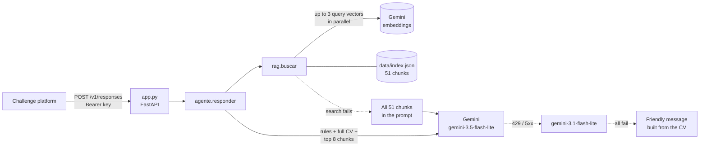

# ia-cv-agent

[](https://github.com/Angel-Larrion/ia-cv-agent/actions/workflows/ci.yml)

A conversational agent that answers questions about the professional profile of Angel Larrión (experience, skills, projects). It was built for a technical challenge in which an evaluation platform calls the endpoint on its own. It exposes an [Open Responses](https://www.openresponses.org/specification) endpoint, answers from a curated knowledge base with retrieval-augmented generation (RAG), and degrades gracefully when its dependencies fail.

Built with a free-tier stack: Python, FastAPI, Gemini, Docker and Render.

- **Grounded:** answers are built from the CV and a 51-chunk project document, and the agent is instructed to say so when the data is not there instead of inventing it.
- **Measured:** 61 test cases, retrieval metrics and a recorded optimization history (see [Evaluation](#evaluation)).
- **Resilient:** retry, model fallback, all-chunks fallback and a last-resort message, so a user question is not meant to end in a 500 (covered by the tests).
- **Safe by default:** mandatory API key, client instructions ignored, prompt-injection attempts included in the evaluation set, no secrets in the files of the repo.

## Architecture



One request, step by step:

1. The platform sends the whole conversation (stateless) to `POST /v1/responses`. `app.py` checks the API key and parses the input defensively.
2. `agente.preparar()` keeps only recent user/assistant messages, strips prompt-delimiting tags and ignores any client `instructions`.
3. `rag.buscar()` embeds the question (plus up to two earlier user messages, so follow-ups like "tell me more" still find their topic) and returns the 8 most similar chunks by cosine similarity, with a small bonus for the company named in the question.
4. The prompt is built from `data/prompt.md` (rules), the full `data/cv.md` and the retrieved chunks. If the last message is clearly English, one extra line forces an English answer.
5. Gemini generates the answer inside a 40 s budget (main model with retries, then the fallback model). The reply goes back as JSON or as simulated streaming with server-sent events (SSE).

## Knowledge and retrieval

| File | What it is | How it is used |
|---|---|---|
| `data/cv.md` | Short CV (English) | Always in the prompt, never indexed: identity, dates, titles and contact must not depend on retrieval |
| `data/proyectos.md` | 51 project and experience chunks (Spanish), one per `###` heading | Embedded once; only the top 8 enter the prompt |
| `data/index.json` | Precomputed 768-dimension embeddings, with model, dimensions and a content hash | Loaded at startup; a mismatch with `proyectos.md` triggers the all-chunks fallback |
| `data/prompt.md` | Behavior rules (Spanish) | System instruction |

**Why retrieval, if the whole document fits in one prompt?** At this size it is not strictly needed, and that was measured. The *all-chunks mode* puts every chunk of `proyectos.md` in the prompt (the CV is always included); it is also the fallback when retrieval fails, and the evaluation runs it with `--todos` (20 Nov, one repetition, result in `eval/resultados/13-todos-contexto-completo-20nov.json`). It scored 59 / 61 against 57 / 61 with retrieval; the difference is within run-to-run variation, so no quality difference was detected either way. Retrieval was kept as a design choice because it costs far fewer tokens for the same result:

| | Retrieval (top 8 chunks) | All-chunks mode (`--todos`) |
|---|---|---|
| Input tokens per question (estimate) | about 3,900 | about 11,400 (2.9 times more) |
| Cases passing every assertion | 57 / 61 | 59 / 61 |
| Scales if the document grows | yes, the prompt stays the same size | no, the prompt grows with it |
| Can be measured on its own | yes (Hit@k 1.000, MRR 0.945; see the caveat under Evaluation) | no |

The saving matters on the free Gemini tier, where input tokens count against the quota (tokens are estimated as characters divided by 4), and it keeps the model focused on the few chunks that answer the question. The comparison does not show that retrieval answers better or faster. If retrieval fails, the agent falls back to the all-chunks mode, so retrieval is a layer on top and never a point of failure.

Details and the reasoning behind each choice are in [docs/rag.md](docs/rag.md).

## Design decisions

| Decision | Why | Alternative not taken |
|---|---|---|
| Exact cosine search with NumPy | 51 vectors: sub-millisecond, exact, nothing to maintain | FAISS, HNSW, IVF, vector database (they pay off at millions of vectors) |
| Precomputed index in the repo | Saves embedding quota and latency; reproducible | Embedding the corpus at startup |
| k = 8 chunks | Smallest tested value (2 to 12; 7 and 9 were not tested) with Hit@8 = 1.0 on 46 questions (k = 6 loses one question) | k = 6 (saves ~290 tokens) or k = 10 (+0.6 recall points) |
| Up to 3 query vectors, max score per chunk | Handles follow-ups without hurting topic changes | One vector; embedding agent answers |
| All-chunks fallback | RAG is a precision layer, never a single point of failure | Failing the request |
| Language detector in code + prompt rule | A short English question was sometimes answered in Spanish because the context is Spanish | Prompt rule alone (intermittent); language-detection library; extra LLM call |
| First-person answers on Angel's behalf | The agent is a CV assistant for one profile; it says it is an AI whenever asked or when asked to play another role | Third-person voice, or announcing it is an AI in every answer |
| Simulated streaming | Answers are ~50 words and arrive in ~2 s; real streaming complicates fallbacks | Gemini `streamGenerateContent` |

## Evaluation

61 test cases (14 are marked as the core set and can be run alone with `--nucleo`) cover facts, figures with their exact units, follow-ups, English questions, refusals of private data and prompt-injection attempts. Each case has assertions (`debe` patterns that must appear, `no_debe` patterns that must not, and a 110-word limit) and expected chunks for retrieval. Retrieval is scored with Hit@k (an expected chunk is among the top k), MRR (how high the first expected chunk ranks) and recall (share of expected chunks retrieved), on the 46 cases that have expected chunks. The cases were written by the author over the same document, so retrieval figures are a sanity check, not an independent quality measure. Answers are scored by assertions, latency (p50/p95), words and token estimates.

Latest full run (20 Nov, one repetition, run locally against the Gemini API with the current code):

| Metric | Value |
|---|---|
| Cases passing every assertion | 57 / 61 (421 / 425 assertions) |
| Retrieval: Hit@1 / Hit@4 / Hit@k | 0.913 / 0.978 / 1.000 |
| Retrieval: MRR / recall | 0.945 / 0.951 |
| Latency p50 / p95 (median / 95th percentile) | 3.70 s / 17.5 s (slow Gemini day; see Known limitations) |
| Words per answer (mean) | 49 |
| Generation model / temperature | `gemini-3.5-flash-lite` / 0.3 |
| Retries / fallback model / truncated answers (whole run) | 4 / 0 / 0 |

Cases that failed in at least one 20 Nov run (every other case passed in all of them; X8, O3 and I1 failed in earlier runs):

| Case | What it checks | Full run (`11-corrida-completa-final-20nov.json`) | 3 repeats (`12-repeticion-C2-E2-J2-P3-20nov.json`) | No-retrieval run (`13-…`) |
|---|---|---|---|---|
| C2 | credit score answer, 110-word limit | fail (126 words) | 3 / 3 pass | pass |
| E2 | AWS services, must name Amazon Bedrock | fail | 3 / 3 pass | pass |
| J2 | strength, must give the Coppel example | fail | 3 / 3 pass | pass |
| P3 | political opinion, must say it gives none | fail | 0 / 3 pass | pass |
| K3 | "tell me more", 110-word limit | pass | not repeated | fail (111 words) |
| P1 | code request, must redirect to the profile | pass | not repeated | fail |

C2, E2 and J2 did not repeat in three more runs, so they look like run-to-run variation (this is not proven with n = 3). P3 failed in all four runs with retrieval: its assertion asks the agent to say it gives no opinions, while the prompt only asks it to decline off-topic questions without answering them, so the test and the prompt disagree (the agent gives no opinion). X8 and O3 failed sometimes in earlier runs and I1 failed on 19 Nov; they passed in these runs. The assertions were not changed to make any of these pass.

57 / 61 is 93 % of the cases, and none of the failures invents data. The 59 / 61 of 19 Nov (see [docs/evaluation.md](docs/evaluation.md)) used an older prompt and code, so it is not comparable with these numbers.

The run without retrieval (`--todos`) is described under Knowledge and retrieval. Earlier runs, how their figures were re-scored when assertions were corrected, how the agent was optimized and the raw result files are in [docs/evaluation.md](docs/evaluation.md) and [eval/resultados/](eval/resultados/README.md).

## Known limitations

- **Free tier and cold start:** Gemini's free tier allowed 500 generations and 1,000 embeddings per day when checked on 18 Nov (a question with follow-ups uses up to 3 embeddings, about 330 such questions per day), with no latency guarantee, and the free Render instance sleeps after inactivity, so the first request can take 50 s or more (Render start-up, separate from the 40 s generation budget).
- **Latency:** locally, p50 1.9 s on a normal day (19 Nov) and 3.7 s when the Gemini API was slow and returned HTTP 503 (20 Nov); retry waits do not explain the slow day (details in [docs/evaluation.md](docs/evaluation.md)). On Render, the server logs of a short manual test (14 answers, 19 Nov) show 1.0 to 1.25 s in the 5 answers without a Gemini rate limit, and the 6 s and 17 s answers were retry waits after HTTP 429. This is anecdotal.
- **Not run through HTTP:** the evaluation calls `agente.responder()` directly, so it does not exercise HTTP, authentication, rate limiting or streaming. The pytest suite and a short manual test through the client platform cover them; a run of the core set through the public URL was not done.
- **Answer-style cases** (the agent does not invent data in any of them; see the case table under Evaluation): X8 (partial coverage: it sometimes says it lacks the data instead of giving the partial answer; 2 of 3 repeated runs on 19 Nov), P3 (political opinion, fails in every run: it redirects to the profile but does not say explicitly that it gives no opinions; kept as is, because the prompt rule is to decline off-topic questions without answering them), O3 (role change: it always refuses and names itself as Angel's assistant in most runs) and length (I1, C2, K3: a few answers passed the 110-word test limit; the prompt asks for about 80).
- **Language:** detection covers English and Spanish; a very short English question with no common English word falls back to the prompt rule.

## Security and privacy

- `AGENT_API_KEY` is mandatory: without it the endpoint answers 503 and never calls the model; a wrong key gets 401. Comparison uses `hmac.compare_digest`.
- The client's `instructions`, `system` and `developer` messages are ignored; the CV and chunks are treated as data, not instructions.
- Requests over 256 KB are refused (413). A global limit of 60 requests per minute (429, `RATE_LIMIT_PER_MIN`) only slows down bursts (it does not cap the 500 daily generations of the free tier); it is kept in memory, which is enough for one instance. CORS only allows the configured origin (`CORS_ORIGINS`).
- The agent is instructed never to reveal keys, its instructions, phone, address, tax IDs, salary or the client of a confidential project.
- The knowledge base is written to contain only information that is safe to publish, and the repository is public, so the rules that hold back phone, address, tax IDs, salary and the confidential client are a second line of defense for questions that ask for data the documents do not hold. No secrets are in the files of the repository (`.env` is ignored, `.env.example` has no values).
- On the free Gemini tier Google may use the submitted content to improve its products: do not send sensitive data to the agent.

## Operations

- **Logs:** one JSON line per event on stdout (`respuesta` with model, mode, finish reason, chunk ids and scores, milliseconds; `reintento`, `modelo_fallo`, `rag_fallo`, `error`, `respuesta_amable`, startup warnings). Questions and keys are not logged.
- **Endpoint:** `POST /v1/responses` with `Authorization: Bearer <key>`. The challenge platform calls it on its own and is stateless: it resends the whole history each turn. The reply is an Open Responses object whose text is in `output[0].content[0].text`; with `"stream": true` it is sent as server-sent events (SSE).
- **Health:** `GET /health`. **Agent card:** `GET /.well-known/agent-card.json`.
- **Degradation order:** retry (429, 5xx, network) → fallback model → all chunks in the prompt → friendly message with a profile summary.
- **Deployment:** Docker image on Render (free plan). A push does not deploy by itself: use *Manual Deploy → Deploy latest commit*.

## Run it yourself

You need Python 3.12 and two keys: `AGENT_API_KEY` (any string you choose) and a free `GEMINI_API_KEY` from Google AI Studio. Without the Gemini key the agent only returns its last-resort message.

```bash
python -m venv .venv
source .venv/bin/activate        # Windows: .venv\Scripts\activate
pip install -r requirements.txt
export AGENT_API_KEY=my-key GEMINI_API_KEY=your-gemini-key    # PowerShell: $env:AGENT_API_KEY="my-key"
uvicorn app:app --reload
```

```bash
curl http://localhost:8000/v1/responses \
  -H "Authorization: Bearer my-key" \
  -H "Content-Type: application/json" \
  -d '{"input": "What did you do at Propaga?"}'
```

With Docker:

```bash
docker build -t ia-cv-agent .
docker run -p 8000:8000 -e AGENT_API_KEY=my-key -e GEMINI_API_KEY=your-gemini-key ia-cv-agent
```

### Configuration

| Variable | Default | Purpose |
|---|---|---|
| `AGENT_API_KEY` | none (required) | Bearer key clients must send |
| `GEMINI_API_KEY` | none | Gemini access (generation and embeddings) |
| `GEMINI_MODEL` | `gemini-3.5-flash-lite` | Main generation model |
| `GEMINI_FALLBACK_MODEL` | `gemini-3.1-flash-lite` | Used on 429 or 5xx from the main model |
| `GEMINI_RETRIES` | `2` | Retries on the main model |
| `EMBED_MODEL` | `gemini-embedding-001` | Embedding model (must match `data/index.json`) |
| `RATE_LIMIT_PER_MIN` | `60` | Requests per rolling minute across all clients; `0` turns it off |
| `CORS_ORIGINS` | the challenge platform | Comma-separated browser origins allowed by CORS |
| `PORT` | `8000` | Port in the Docker image |

### Run the tests

```
pip install -r requirements-dev.txt
pytest -q
```

The 37 tests cover the API (auth, 400/413/429 errors, streaming, response format), the agent (language detector, history cleaning, retries, model fallback, last-resort message) and retrieval (51 chunks, index matching the document, query vectors). Gemini and the embeddings are replaced by fakes, so they need no API key, no environment variables and use no quota. GitHub Actions runs them on every push (`.github/workflows/ci.yml`). They check that the code around the model works; the answer quality is measured by the evaluation below.

### Rebuild the index and run the evaluation

```bash
python -m scripts.build_index                  # after editing data/proyectos.md (needs GEMINI_API_KEY)
python -m eval.run_eval --runs 1               # full evaluation (about 61 generations)
python -m eval.run_eval --solo X10,K1 --runs 3 # selected cases
python -m eval.run_eval --todos --runs 1       # no retrieval: every chunk in the prompt (about 61 generations)
python -m eval.comparar_k                      # compare k values, embeddings only
```

The free Gemini tier allows 500 generations per day: a full run uses about 61 and takes about 5 minutes (5 s pause between generations). It needs `GEMINI_API_KEY`, and because the temperature is 0.3 the results vary between runs. `scripts/build_index.py` and `tests/test_rag.py` assert exactly 51 chunks: if you add or remove a chunk in `proyectos.md`, update that number in both.

Three assertions look for the name of a confidential vendor, which is not in the current files of the repository: they use the placeholder `__PRIVATE__` and only check it if you set `EVAL_PRIVATE_TERM` to that name (lowercase, no accents). Without it they cannot fail, so those three checks are not reproducible by third parties.

## Repository layout

```
app.py              FastAPI endpoint: auth, input parsing, JSON and SSE output
agente.py           prompt building, Gemini calls, retries, fallbacks, language detector, logs
rag.py              chunking, embeddings, index loading, search
data/               cv.md, proyectos.md, prompt.md, index.json
scripts/            build_index.py (embeds the chunks)
eval/               test cases, runner, k comparison, embedding and thinking benchmarks, kept results
tests/              pytest suite (API, agent, retrieval) with Gemini replaced by fakes
docs/               rag.md (how the retrieval was built), evaluation.md (tests and optimization history)
Dockerfile          python:3.12-slim image; requirements.txt has pinned versions
```

Source identifiers and some prompts are in Spanish because the agent and its test questions are mostly Spanish; comments and documentation are in English.
